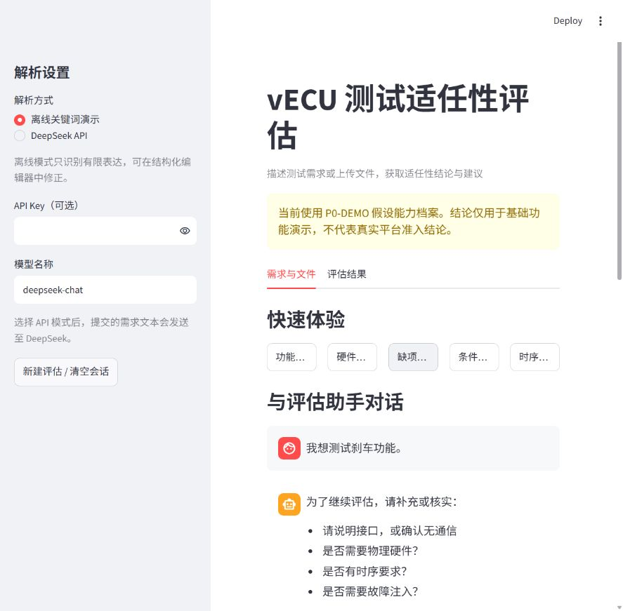
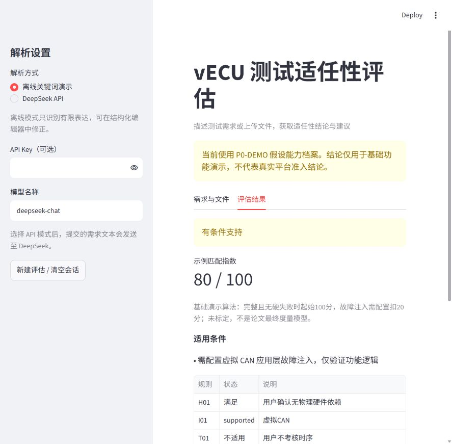

# vECU 测试适任性评估智能体：阶段进展与研究方案

**汇报日期：2026 年 11 月 6 日**  
**阶段定位：方案研究与基础原型验证**  
**项目目录：`D:\Project\vECU-Agent`**

## 一、阶段概况

本课题面向 vECU 测试入口的任务选型问题，研究如何将用户测试需求与指定平台能力进行匹配，在执行测试前给出适任性结论、限制说明和平台选择建议。

当前已完成本地基础原型，形成“自然语言或文件输入—结构化需求—缺项追问—能力匹配—规则评估—结果导出”的流程。当前采用人工构造的平台能力档案和基础判定规则，验证的是功能闭环，尚不能代表企业真实平台的评估效果。

| 内容 | 当前状态 |
| --- | --- |
| 用户对话、缺项追问、结构化需求确认 | 已实现，完成离线交互验证 |
| JSON、CSV、TXT、Markdown 文件读取 | 已实现基础版本 |
| 平台能力档案与规则评估 | 已接入本地原型，能力数据为演示假设 |
| DeepSeek 需求解析 | 已编写调用代码，尚未完成在线效果验证 |
| 企业模型、平台能力服务接口 | 已形成接入设计，尚未实现 |
| 完整适任性指标体系、权重与等级阈值 | 待研究、标定与验证 |
| 40—60 个开发用例 | 已在方案讨论中列出候选场景，尚未整理为完整标注数据集；当前落盘样例为6条 |

## 二、业务定位与研究边界

依据《vECU项目会议纪要_20261028》，近期平台以功能测试、以太网、CAN及虚拟对手件为主要方向。Agent放在测试入口，辅助筛选不适合在指定虚拟环境开展的任务。

本课题聚焦以下问题：

1. 如何将用户描述及用例文件转换为统一、可核查的测试需求？
2. 如何表示平台已经集成、经过验证的能力及其适用条件？
3. 如何结合硬约束和量化指标形成可解释的适任性结论？
4. 如何通过案例和真实测试反馈验证评估的可靠性？

镜像启动、QEMU设备模型开发、Kubernetes调度和测试执行属于整个平台的其他模块。本原型暂不创建环境或启动测试。

## 三、总体方案设计

### 3.1 三个核心部分

**平台能力档案**回答“目标环境能够提供什么”。记录环境版本、接口、资源、软件运行条件、故障注入能力、时序验证证据和限制。

**需求理解与对话模块**回答“用户需要验证什么”。从自然语言和文件中抽取目标、接口、硬件依赖、时序及资源等信息；对关键缺项追问；允许用户修正。

**评估模型**回答“该任务在这个平台上能否可靠开展”。先检查必要条件，再对适用指标进行计算，输出结论及依据。

```text
平台配置 / 验证记录 → 平台能力档案 ─────────────┐
                                              ↓
用户自然语言 / 用例文件 → 需求抽取 → 缺项追问 → 硬约束检查
                                      ↑              ↓
                                   用户补充       指标评估
                                                     ↓
                                      结论、限制、依据与平台建议
```

评估对象是“某项测试任务在某个指定版本环境上的适任性”。同样是CAN测试，报文解码与真实电气波形验证具有不同的能力要求。

### 3.2 大模型与评估程序的分工

大模型负责理解语言、抽取参数；程序负责字段校验、缺项判断、当前基础追问和最终规则判定。平台能力不能由模型自行推断。

当前提供离线关键词演示及DeepSeek API两种方式。离线模式只识别有限表达；API模式调用模型提取统一JSON，并携带最近对话上下文。当前追问由规则中的缺项列表生成，尚未实现模型自由规划和自适应追问排序。

### 3.3 当前连接方式与后续服务化

当前是单进程本地原型：`app.py`读取`capabilities.json`，调用`core.py`中的`evaluate()`。这里使用Python函数调用，尚未建设独立HTTP后端。

后续可将能力查询、需求解析和评估服务封装为接口。建议接口职责如下，均为待实现设计：

| 接口 | 作用 |
| --- | --- |
| `GET /environments/{id}/capabilities` | 返回指定版本能力快照及证据 |
| `POST /requirements/parse` | 将文本转换为结构化需求 |
| `POST /assessments` | 对需求及环境快照执行评估 |
| `GET /assessments/{id}` | 查询结果及历史依据 |

平台能力档案由后台维护，用户页面聚焦需求输入和结果。结果中保留必要的限制和依据，不要求用户查看整份能力配置。

## 四、当前已完成工作

### 4.1 对话与需求模型

已支持聊天输入和双方消息记录。每轮补充更新当前需求；未知硬件依赖保持为空，不自动视为无依赖。需求变化或解析失败时清除旧评估结果，避免继续展示过期结论。

| 字段 | 含义 |
| --- | --- |
| `goal` | 具体测试目标 |
| `interface` | 虚拟CAN、真实CAN、以太网、其他协议或无通信 |
| `hardware` | 是否依赖物理硬件，支持未知值 |
| `timing` / `latency_ms` | 是否有时序要求及响应时间数值 |
| `memory_gib` | 内存需求 |
| `fault` | 无故障注入、报文丢弃或延迟注入 |

已实现枚举、布尔、正数和部分字段冲突校验，以及常见时间和内存单位换算。当前goal允许自由文本，复杂需求中的多目标拆分和语义完整性仍需加强。



*图1为2026年11月6日实际原型截图，使用离线关键词演示模式。用户只描述“测试刹车功能”后，助手要求补充接口、硬件、时序与故障注入信息。*

### 4.2 文件读取与批量评估

| 文件 | 当前处理方式 | 边界 |
| --- | --- | --- |
| JSON | 读取需求对象或对象数组，校验结构 | 需使用现有字段名 |
| CSV | 每行读取text列文本，再抽取字段 | 仅支持单列模板 |
| TXT / Markdown | 提取UTF-8文本后解析 | 整份文件作为一条需求 |

已提供批量结论表及JSON结果下载。读取位置可以定位至文件条目或CSV行；尚未实现自由格式文档的逐字段原文定位。Excel、Word、PDF、扫描件和源码依赖分析尚未接入。单条文本限制20000字符，解析文件限制2 MiB、批量最多100条。

文件内容仅作为需求数据，不应作为改变系统规则的指令。相关抗诱导能力尚需通过模型实验验证。

### 4.3 平台能力档案

当前`capabilities.json`保存P0-DEMO示例环境：虚拟CAN和以太网可用，真实CAN不支持，单实例内存上限4 GiB，尚无时序保证证据。

这些均为演示假设，并非企业当前环境事实。当前物理硬件、时序和故障注入规则仍含演示环境专用逻辑，尚未全部参数化；后续不能仅修改JSON就声称支持任意平台。

### 4.4 基础评估引擎

当前采用确定性规则：

| 检查项 | 基础处理 |
| --- | --- |
| 物理硬件依赖 | 演示环境不支持时触发拦截 |
| 接口匹配 | 明确不支持则拦截，目录未确认则信息不足 |
| 时序要求 | 没有可用实测证据时要求核实 |
| 内存容量 | 需求超过单实例上限则不支持 |
| 虚拟CAN应用层故障注入 | 提示需配置，输出有条件支持 |
| 关键需求缺项 | 提示补充，保持信息不足 |

已知硬失败优先于缺项；无硬失败但有缺项则返回信息不足；其后区分有条件支持与支持。报告记录规则版本、环境版本及检查说明。



*图2展示报文丢弃后的降级逻辑测试。系统提示需要配置应用层故障注入。页面80分是演示匹配指数，不是研究标定后的适任性得分。*

## 五、评估模型的研究设计

当前实现可作为规则基线，完整模型拟采用“硬约束＋多维度度量＋证据完整性”结构。

| 研究维度 | 拟评价内容 | 所需数据 |
| --- | --- | --- |
| 仿真精度 | 模型是否覆盖测试目标所关注的行为及允许误差 | 参考结果、模型验证记录、误差范围 |
| 时序适配 | 响应时间、周期、抖动是否满足要求 | 相同负载与统计口径下的实测数据 |
| 资源开销 | CPU、内存、执行时间与并发成本 | 任务剖析、平台监控和容量数据 |
| 故障注入 | 注入层级、类型及可控性是否匹配 | 注入工具能力与验证记录 |
| 软件与接口适配 | 架构、OS、协议、对手件和软件依赖是否兼容 | 环境配置和兼容性验证记录 |

对于通过硬约束、且具有必要证据的任务，可研究加权模型：

`S = Σ(w_i × s_i)，Σw_i = 1`

实施顺序：先定义各指标可观测依据和归一化方式，以等权重作为基线，再根据专家意见研究AHP等赋权方法，检验一致性并开展权重敏感性分析。等级阈值需由案例和专家判断校准。缺失指标不能默认为满分，单纯提高总分不能覆盖硬约束失败。

当前演示算法只是在完整且无硬失败时给100分，需要配置故障注入时给80分。该算法仅展示结果链路，不能作为论文最终方法或有效性证据。

## 六、已完成验证与尚未验证内容

已运行`test_demo.py`，覆盖6个规则场景、部分输入与文件读取检查，以及5条Streamlit页面交互流程。

| 离线场景 | 当前结果 |
| --- | --- |
| 虚拟CAN解码、无硬件依赖、无时序要求 | 支持 |
| 真实CAN电压验证 | 不支持 |
| 仅描述刹车功能 | 信息不足 |
| 虚拟CAN丢弃注入 | 有条件支持 |
| 500微秒响应要求、无时序证据 | 信息不足 |
| 内存8 GiB、平台上限4 GiB | 不支持 |

另完成两轮对话检查：首次描述目标后产生追问；补充接口、硬件、时序与注入信息后合并字段，并提示需求收集完整。

上述验证证明指定样例下的代码行为符合预期，不等于需求理解准确率或真实业务有效性。尚未验证DeepSeek在线抽取效果、复杂否定及矛盾、多文档融合、企业实际能力和真实任务结果。当前也没有经过独立测试集评估，不报告准确率百分比。

## 七、开发用例与实验安排

### 7.1 数据集建设

将前期讨论的40条对话需求及12类文件场景整理成约40—60个正式开发场景。每条包含：输入、环境版本、预期字段、应追问项、专家标签、依据和来源类型。文件数、独立任务数和对话轮数分别统计。

构造案例用于开发；另留独立测试集。相同场景的改写放入同一划分，避免信息泄漏。取得企业用例后，由熟悉平台的人员复核标签，并区分人工构造与真实案例。

### 7.2 对比与消融实验

| 实验 | 比较方案 | 指标 |
| --- | --- | --- |
| 需求抽取 | 离线关键词与大模型抽取 | 字段准确率、未知保留率、单位换算正确率 |
| 评估方法 | 纯模型判断、模型＋规则、模型＋规则＋能力证据 | 各类精确率/召回率、混淆矩阵 |
| 对话效果 | 一次性输入与缺项追问 | 完成率、追问覆盖率、平均轮数 |
| 文件解析 | 标准结构化文件与自然语言文档 | 条目拆分、字段抽取及来源定位正确率 |
| 鲁棒性 | 改写、否定、需求修改、诱导文本 | 一致性及错误放行率 |

重点统计“真实标签为不支持或信息不足，却被系统判为支持”的情况，并单独检查有条件支持是否存在不恰当放行。实验记录模型名称、提示词版本、原始响应、环境与规则版本、耗时及失败原因。

## 八、后续实施计划

以下为相对当前阶段的建议安排，需结合企业资料和导师意见调整。

| 阶段 | 主要任务 | 可检查成果 |
| --- | --- | --- |
| 第1周 | 确认研究边界；梳理企业能力清单；将规则中的环境假设参数化 | 能力目录v1、字段字典、规则清单 |
| 第2周 | 整理40—60个开发场景；按企业文件样例优先增加Excel，再考虑Word/PDF | 标注数据集、文件模板、来源定位记录 |
| 第3周 | 开展真实模型调用实验；完善对话冲突处理、未知值及追问策略 | 模型实验日志、字段抽取结果和误差分析 |
| 第4周 | 形成指标归一化方案与评分基线；完成对比和敏感性实验 | 指标模型v1、实验表格、阶段结论 |
| 后续集成 | 企业模型适配、能力API接入、真实任务与执行结果复核 | 联调记录、真实案例评估报告 |

企业大模型接入时，保留统一需求JSON及评估引擎。兼容接口可配置地址、模型和认证；自定义接口则增加适配器。当前尚未抽离完整模型适配层，模型切换后也需重新运行相同测试集。

## 九、需与导师及企业确认的问题

1. 首期限定哪些测试目标：建议优先功能、虚拟CAN与以太网接口行为。
2. 谁提供和确认平台能力，能否取得镜像、协议栈、设备及验证记录？
3. 能否提供匿名化测试用例文件，以及真实执行成功/失败案例？
4. 仿真精度与时序证据的参考来源是什么，哪些指标能在现有条件下实测？
5. 企业模型接口何时可用，需求数据是否允许使用外部模型？

## 十、演示与项目文件

启动方式：

```powershell
cd D:\Project\vECU-Agent
python -m streamlit run app.py
```

建议演示顺序：点击“缺项追问”查看助手问题；补充当前需求；确认结构化字段后评估；点击“硬件拦截”查看限制；上传`samples/requirements.json`查看批量结果；下载评估报告。

| 文件 | 作用 |
| --- | --- |
| `../app.py` | Streamlit对话、上传和结果界面 |
| `../core.py` | 字段校验、关键词解析、文件读取、规则评估 |
| `../capabilities.json` | P0-DEMO能力配置 |
| `../samples/` | 6条JSON和CSV演示需求 |
| `../test_demo.py` | 可重复运行的基础验证 |
| `../demo_results.json` | 离线场景输出 |
| `images/` | 本报告实际页面截图 |

前期资料：《vECU适任性评估Agent综合调研报告(1).md》《vECU项目会议纪要_20261028.docx》。其中的建设建议与目标作为研究输入，不视为平台已实现能力或已达成实验指标。
